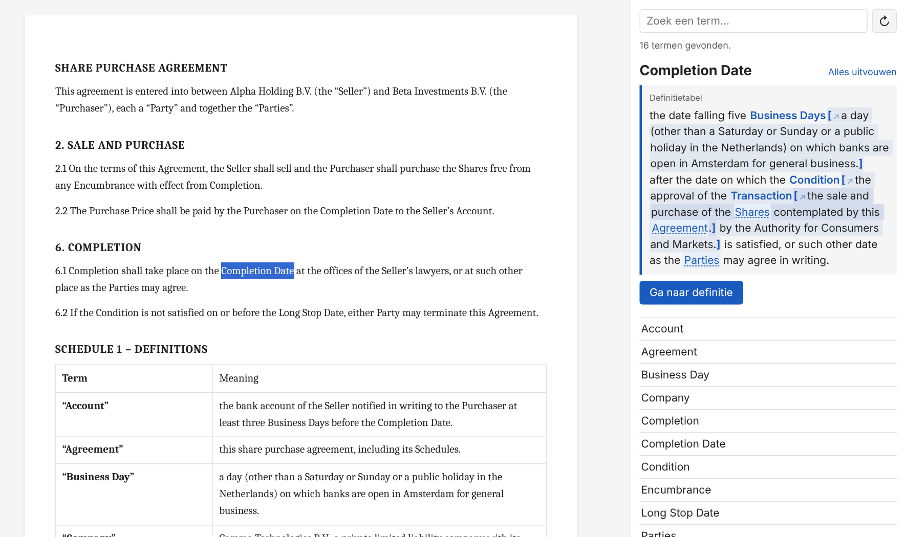

# Definities – Word-add-in voor gedefinieerde termen

Een add-in voor Word die bij het lezen van contracten direct de betekenis van gedefinieerde termen toont. Klik in de tekst op een term, zoals *Completion Date*, en het zijpaneel toont de definitie uit de schedule. Komen in die definitie weer gedefinieerde termen voor, dan vouw je die met een klik uit op de plek in de tekst. Zo lees je de volledige definitie in één keer.



**Voor IT:** de installatie staat in [docs/installatie-it.md](docs/installatie-it.md).

## Gebruik

1. Open in Word het tabblad **Start** en klik op **Definities**. Het zijpaneel opent en leest het document in.
2. Klik in de tekst in een gedefinieerde term. Het paneel toont de betekenis.
3. Klik in de definitie op een onderstreepte term om die tussen [ ] uit te vouwen. Nog een keer klikken klapt hem in. **Alles uitvouwen** vouwt de hele keten in één keer uit.
4. Met **↗** open je een uitgevouwen term als losse term. Via het pad bovenin ga je terug.
5. **Ga naar definitie** springt naar de definitie in het document en **Terug naar tekst** brengt je terug naar waar je was.
6. Met het zoekveld vind je elke term in het document. Na wijzigingen in het document lees je het opnieuw in met **↻**.

Word laat add-ins niet reageren op een muis die boven tekst hangt, alleen op de cursor. Daarom werkt het met een klik in de term en niet met hover.

## Wat er herkend wordt

- **Definitietabellen** met de term links en de betekenis rechts. Een kopregel zoals *Term / Meaning* of *Begrip / Betekenis* wordt overgeslagen. Andere tabellen worden genegeerd.
- **Definitiebepalingen**, zoals `"Agreement" means …`, `"Encumbrance": …`, `"Koper" betekent …` en `Onder "Aandelen" wordt verstaan: …`.
- **Definities in de lopende tekst**, zoals `(the "Seller")`, `(hierna: "Koper")`, `hierna te noemen "Verkoper"` en `each a "Party" and together the "Parties"`.

**Herkennen van termen in de tekst:**
- Hoofdletters moeten kloppen.
- Meervouden (*Business Days*) en bezittelijke vormen (*Seller's*) worden herkend.
- Langere termen gaan voor kortere: in *Completion Date* wordt niet alleen *Completion* gezien.

## Vertrouwelijkheid

Het document wordt in Word op de eigen computer gelezen. Er gaat geen contracttekst naar een server of externe dienst. De add-in wijzigt het document niet.

## Uitproberen zonder Word

Open `web/taskpane.html` in een browser, of draai `npm start` (Node.js 18 of nieuwer) en ga naar http://localhost:8080/taskpane.html. Buiten Word start de pagina in demo-modus met een voorbeeldcontract.

Met **Open Word-document**, of door een `.docx` op de pagina te slepen, test je een eigen contract. Het bestand wordt alleen in de browser gelezen. De omzetting naar een webpagina kan op details afwijken van Word, bijvoorbeeld bij automatische nummering. Voor het testen van de herkenning maakt dat niet uit.

## Voor ontwikkelaars

```
web/                 de add-in (statische bestanden; dit komt op de webserver)
  taskpane.html      het zijpaneel
  taskpane.js        weergave en koppeling met de Word-API
  definitions.js     herkenning van definities en termen (geen Word-API, getest)
  demo.js            demo-modus buiten Word, met voorbeeldcontract en .docx openen
  vendor/            mammoth.js, alleen gebruikt om in de demo een .docx te openen
manifest.xml         add-in-manifest met een plaatshouder-adres
scripts/build.js     maakt het installatiepakket in dist/ (npm run build)
scripts/serve.js     lokale server voor de demo (npm start)
test/                tests (npm test)
docs/                installatiehandleiding voor IT en screenshot
```

Tests draaien met `npm test` en bij elke push via GitHub Actions. Er zijn geen externe npm-pakketten nodig.
